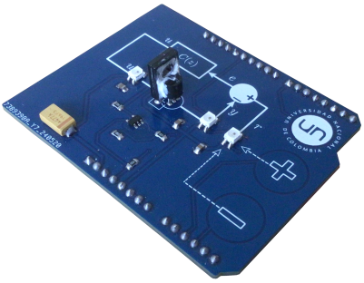

```@meta
CurrentModule = ThermoLab
```

# ThermoLab.jl

Laboratorio portátil de control de temperatura.


Este paquete de Julia permite hacer experimentos de control e identificación con la plataforma  de experimentación portátil llamada **ThermoLab**. Esta plataforma contiene un sistema térmico formado por un calefactor (transistor BD139) y un sensor
de temperatura DS18B20. La plataforme funciona por medio de un microcontrolador ESP32.



La plataforma trabaja con un periodo de muestreo de 0.8 s. La temperatura de referencia puede fijarse entre la temperatura ambiente y 95 °C, y la señal de control es la potencia aplicada al calefactor, expresada en porcentaje (entre 0 y 100 %).

### Instalación

1. Instale el firmware de la placa con base en las instrucciones de  [Instalación del Firmware](@ref)

2. Instale el paquete con base en las instrucciones de [Instalación del paquete](@ref).


### Funciones
- Para el listado completo de funciones, ver el panel izquierdo.
